# Mutant Dices

**Clear, readable dice for the [Mutant: Year Zero](https://foundryvtt.com/packages/mutant-year-zero) system on [Foundry VTT](https://foundryvtt.com/).**

Mutant Dices gives the base, skill and gear dice faces that look like the physical dice: numbers you can read at a glance, radiation on the 6, biohazard and explosion on the 1. You get the same faces on the 3D dice, in every chat roll, and in a new quick dice roller.

> **Free, unofficial fan module.** Mutant Dices is made by a fan, costs nothing and never will. It is not affiliated with or endorsed by Free League Publishing. See [Disclaimer](#disclaimer).

Version 1.0 is the first stable release: everything below is tested and working on Foundry v14. The module is still actively developed, so new features may come. Found a bug or have an idea? [Open an issue](https://github.com/f-fabner/mutant-dices/issues).

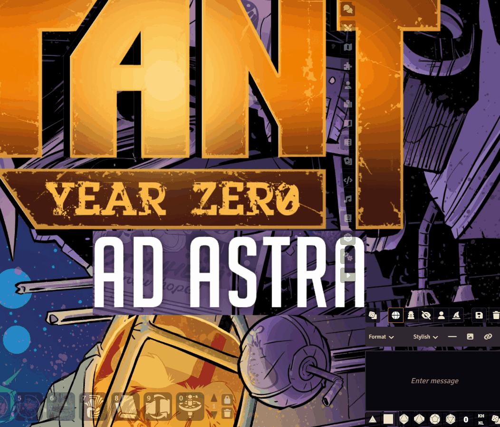

## Before and after

| | Without Mutant Dices | With Mutant Dices |
| --- | --- | --- |
| **Roll from the character sheet** | 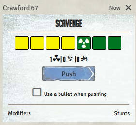 | 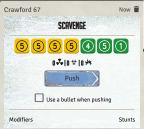 |
| **`/r 3db + 2ds + 1dg` in chat** | 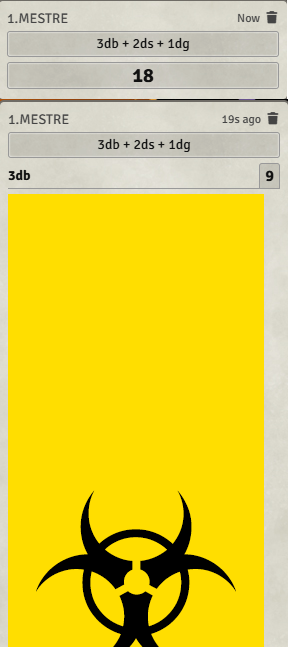 | 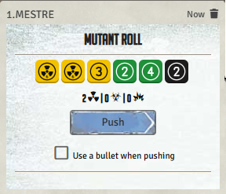 |

## Features

### Dice faces that make sense

Every face shows what it means, in the colors of the system's dice:

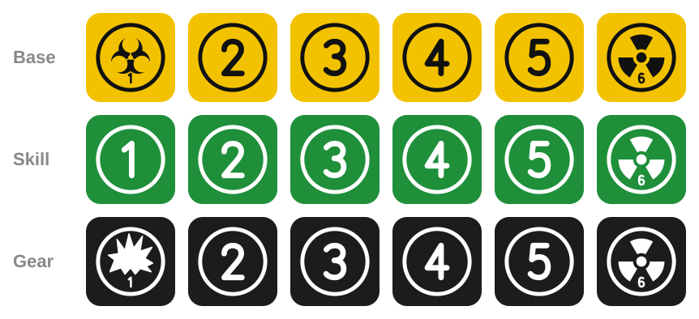

| Die | 1 | 2 – 5 | 6 |
| --- | --- | --- | --- |
| **Base** (yellow) | Biohazard: trauma | Number in a circle | Radiation: success |
| **Skill** (green) | Number 1 | Number in a circle | Radiation: success |
| **Gear** (black) | Explosion: gear damage | Number in a circle | Radiation: success |

### Colorblind modes

Each player can pick the dice colors that work for them in **Configure Settings → Mutant Dices → Dice colors**. The colorblind options use colors chosen to stay distinct for each type of color blindness, and also give each die its own ring style, so you can tell the dice apart even without color: **base** has a solid ring, **skill** a double ring and **gear** a dashed ring. The choice only changes what you see; the other players keep their own.

| Option | Faces |
| --- | --- |
| **Universal** and **Deuteranopia / protanopia** (red-green) | 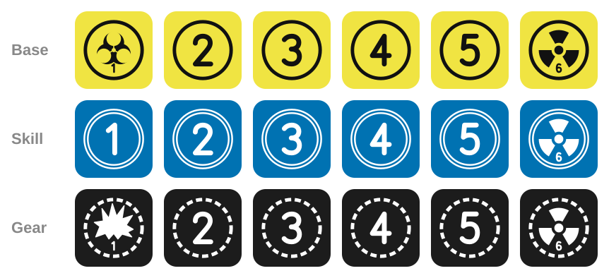 |
| **Tritanopia** (blue-yellow) | 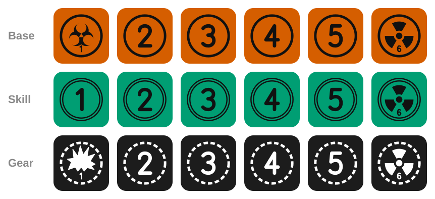 |
| **Achromatopsia** (grayscale) | 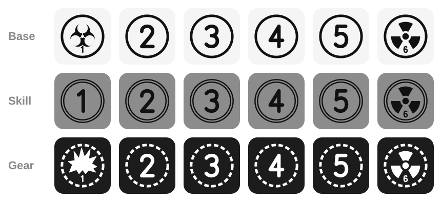 |

### 3D dice with Dice So Nice

With [Dice So Nice](https://foundryvtt.com/packages/dice-so-nice) installed, every Mutant roll throws 3D dice with the new faces: rolls from the character sheet, from the dice roller and from chat commands.


The Mutant Dices set is selected by default. You can switch back to the system's original dice in the Dice So Nice settings at any time.

### Readable results in chat

The system's roll card now shows each die with its number or symbol, so you can see exactly what was rolled. The usual summary of successes, trauma and gear damage stays below the dice.

<p>
  
</p>

### Pushing works as usual

The **Push** button rerolls the dice that didn't show a success, trauma or gear damage, and the pushed card uses the same faces.

<p>
  
  
</p>

### Quick dice roller

A new dice button opens the **Mutant Dice Roller**: choose a name for the roll and how many base, skill and gear dice to throw, then click **Roll**. The roll goes through the system's own roll card, so it can be pushed like any other roll.

The gear icon in the roller's title bar opens the module's settings, where you can change the dice colors or the module language.

The button is next to the roll mode buttons, under the chat:

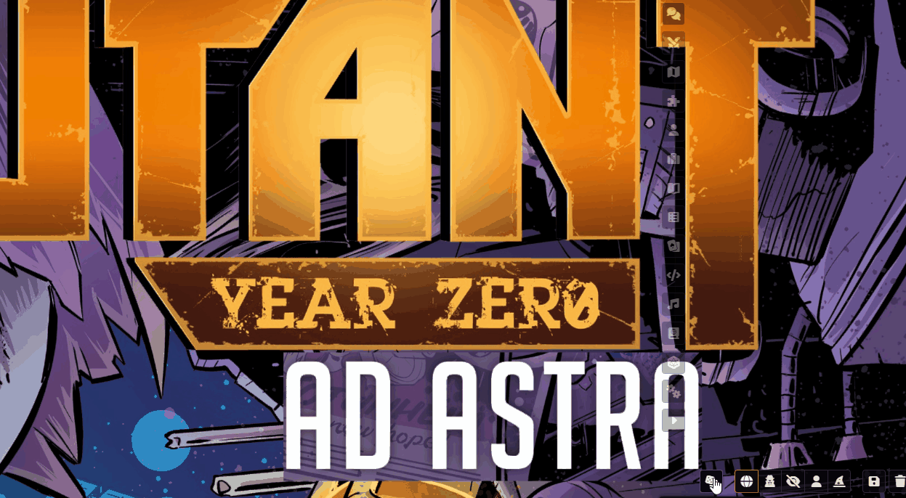


<p>
  
  
</p>

The same button is also in the **Token controls** on the left of the canvas.

### Chat commands

You can also roll Mutant dice straight from chat: `db` is a base die, `ds` a skill die and `dg` a gear die. You get the full roll card with the new faces and the **Push** button, just like a roll from the character sheet.

Type `/r 3db + 2ds + 1dg` to roll 3 base, 2 skill and 1 gear dice. The card is called "Mutant Roll":

<p>
  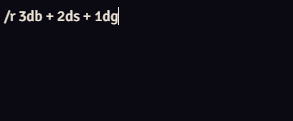
  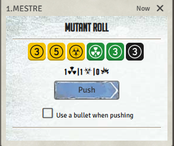
</p>

Add a name after `#` to label the roll, for example `/r 3db + 2ds + 1dg # Shoot`. The name stays on the card when you push:

<p>
  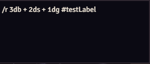
</p>
<p>
  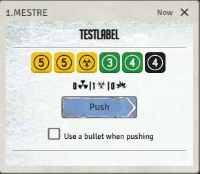
  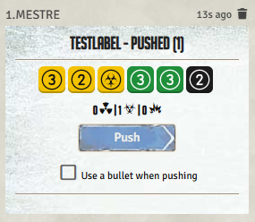
</p>

- Each push adds "Pushed (1)", "Pushed (2)" and so on to the title.
- If a token is selected, the roll is made as that character.
- `/roll` works too, and upper case is fine (`/R 3DB`).
- Commands with anything else in them, like `/r 2db + 1d20`, are normal Foundry rolls.
- The card uses the roll mode selected under the chat (public, private GM, blind, self). A command that asks for a different mode, like `/gmr 2db` while the chat is set to public, keeps that mode: it still shows the new faces and the count of successes, trauma and gear damage, but can't be pushed.

## Installation

In Foundry, go to **Add-on Modules → Install Module** and paste this manifest URL:

```
https://github.com/f-fabner/mutant-dices/releases/latest/download/module.json
```

Then enable **Mutant Dices** in your world under **Game Settings → Manage Modules**.

## Requirements

- Foundry VTT v13 or v14
- The [Mutant: Year Zero](https://foundryvtt.com/packages/mutant-year-zero) system
- [Dice So Nice](https://foundryvtt.com/packages/dice-so-nice) (optional, for the 3D dice)

## Settings

- **Dice colors:** the default colors or a colorblind mode. Each player chooses for themselves.
- **Module language:** show this module in English or Portuguese, or follow Foundry's language. Each player chooses for themselves.
- **Mutant Dices faces in chat:** turn the new faces in chat on or off. Each player can choose for themselves.
- **Push for /r rolls:** chat commands with only Mutant dice use the system's roll card, so they can be pushed. Set by the GM for the whole world. Turn it off to get plain rolls instead.

## For macro authors

Open the dice roller from a macro with:

```js
game.modules.get("mutant-dices").api.openRoller();
```

## Development

To test locally, create a symbolic link from this folder to `Data/modules/mutant-dices` inside your Foundry user data folder.

The dice faces are generated by `tools/build-dice-faces.mjs`. After changing it, run:

```
npm run build:faces
```

| Path | Contents |
| --- | --- |
| `module.json` | Module manifest |
| `scripts/` | JavaScript code (ES modules) |
| `styles/` | CSS |
| `lang/` | Localization files |
| `templates/` | Handlebars templates |
| `assets/dice/` | Dice faces (SVG, used in chat and by Dice So Nice) |
| `docs/images/` | Screenshots for this README (not shipped) |
| `tools/` | Development scripts (not shipped) |

To publish a version, create a `vX.Y.Z` tag and publish a GitHub Release. The workflow in `.github/workflows/release.yml` builds `module.zip` and `module.json` with the correct version and URLs.

## Disclaimer

- **Unofficial.** Mutant Dices is an unofficial, fan-made module. It is not affiliated with, endorsed, sponsored or approved by Free League Publishing (Fria Ligan AB).
- **Rights.** Mutant: Year Zero and all related names, trademarks and content are the property of Free League Publishing. All rights reserved by their respective owners.
- **Free.** This module is completely free. It is not sold, there is no paid version, and no money or donations are asked for.
- **Original artwork.** The dice faces were drawn from scratch for this module, using common symbols (numbers, radiation, biohazard, explosion). No art was copied from official products. The module needs the [Mutant: Year Zero system](https://foundryvtt.com/packages/mutant-year-zero) and doesn't include any game rules or book content.
- **Why it exists.** I made it, with the help of Claude (Anthropic's AI assistant), to make dice easier to read at my own table, and I'm sharing it so every Mutant table on Foundry can use it too.

If you own rights to any of this material and have a concern, please [open an issue](https://github.com/f-fabner/mutant-dices/issues) and it will be addressed promptly.

## License

The code and the dice face artwork of this module are released under the [MIT license](LICENSE). This license covers only this module's own work, not Mutant: Year Zero or any Free League Publishing content.
