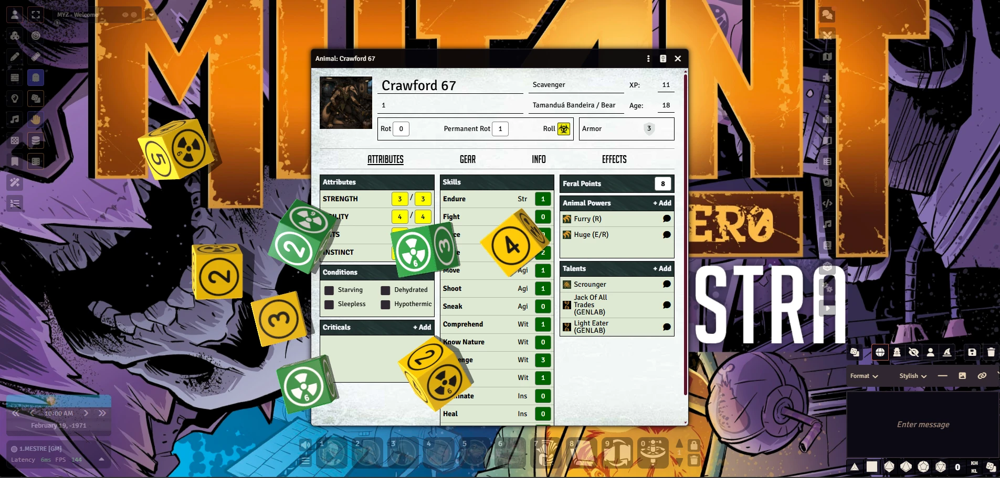
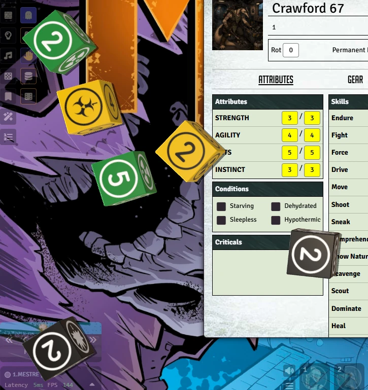
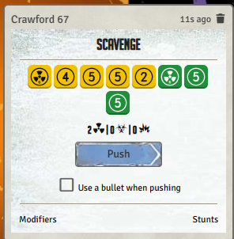
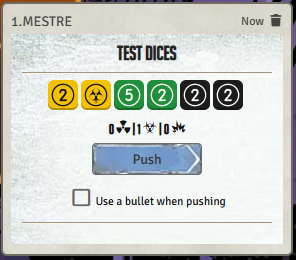
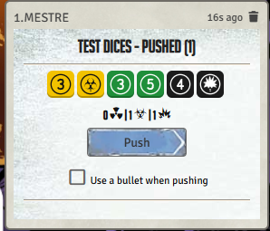
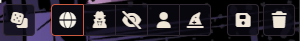
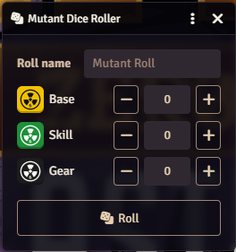
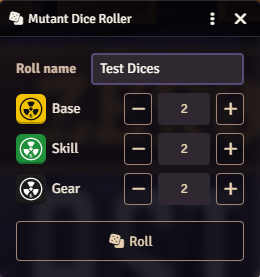
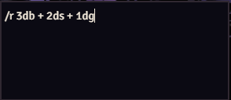
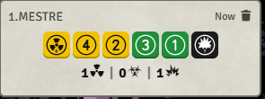

# Mutant Dices

**Clear, readable dice for the [Mutant: Year Zero](https://foundryvtt.com/packages/mutant-year-zero) system on [Foundry VTT](https://foundryvtt.com/).**

Mutant Dices gives the base, skill and gear dice faces that look like the physical dice: numbers you can read at a glance, radiation on the 6, biohazard and explosion on the 1. You get the same faces on the 3D dice, in every chat roll, and in a new quick dice roller.

> **Work in progress.** The module works, but it is still being developed. Expect changes, and please [report any bugs](https://github.com/f-fabner/mutant-dices/issues).



## Features

### Dice faces that make sense

Every face shows what it means, in the colors of the system's dice:


| Die | 1 | 2 – 5 | 6 |
| --- | --- | --- | --- |
| **Base** (yellow) | Biohazard: trauma | Number in a circle | Radiation: success |
| **Skill** (green) | Number 1 | Number in a circle | Radiation: success |
| **Gear** (black) | Explosion: gear damage | Number in a circle | Radiation: success |

### 3D dice with Dice So Nice

With [Dice So Nice](https://foundryvtt.com/packages/dice-so-nice) installed, every Mutant roll throws 3D dice with the new faces: rolls from the character sheet, from the dice roller and from chat commands.



The Mutant Dices set is selected by default. You can switch back to the system's original dice in the Dice So Nice settings at any time.

### Readable results in chat

The system's roll card now shows each die with its number or symbol, so you can see exactly what was rolled. The usual summary of successes, trauma and gear damage stays below the dice.

<p>
  
</p>

### Pushing works as usual

The **Push** button rerolls the dice that didn't show a success, trauma or gear damage, and the pushed card uses the same faces.

<p>
  
  
</p>

### Quick dice roller

A new dice button opens the **Mutant Dice Roller**: choose a name for the roll and how many base, skill and gear dice to throw, then click **Roll**. The roll goes through the system's own roll card, so it can be pushed like any other roll.

The button is next to the roll mode buttons, under the chat:



<p>
  
  
</p>

The same button is also in the **Token controls** on the left of the canvas.

### Chat commands

You can also roll Mutant dice straight from chat. Type for example `/r 3db + 2ds + 1dg` (`db` = base, `ds` = skill, `dg` = gear) and you get the full roll card with the new faces and the **Push** button, just like a roll from the character sheet.

- Add a name after `#`: `/r 3db + 1ds # Sneak` shows "Sneak" on the card.
- If a token is selected, the roll is made as that character.
- `/roll` works too, and upper case is fine (`/R 3DB`).
- Commands with anything else in them, like `/r 2db + 1d20`, are normal Foundry rolls. Plain rolls with Mutant dice, like `/gmr 2db`, still show the new faces and the count of successes, trauma and gear damage, but can't be pushed.

<p>
  
  
</p>

## Installation

In Foundry, go to **Add-on Modules → Install Module** and paste this manifest URL:

```
https://github.com/f-fabner/mutant-dices/releases/latest/download/module.json
```

Then enable **Mutant Dices** in your world under **Game Settings → Manage Modules**.

## Requirements

- Foundry VTT v13 or v14
- The [Mutant: Year Zero](https://foundryvtt.com/packages/mutant-year-zero) system
- [Dice So Nice](https://foundryvtt.com/packages/dice-so-nice) (optional, for the 3D dice)

## Settings

- **Mutant Dices faces in chat:** turn the new faces in chat on or off. Each player can choose for themselves.
- **Push for /r rolls:** chat commands with only Mutant dice use the system's roll card, so they can be pushed. Set by the GM for the whole world. Turn it off to get plain rolls instead.

## For macro authors

Open the dice roller from a macro with:

```js
game.modules.get("mutant-dices").api.openRoller();
```

## Development

To test locally, create a symbolic link from this folder to `Data/modules/mutant-dices` inside your Foundry user data folder.

The dice faces are generated by `tools/build-dice-faces.mjs`. After changing it, run:

```
npm install
npm run build:faces
```

| Path | Contents |
| --- | --- |
| `module.json` | Module manifest |
| `scripts/` | JavaScript code (ES modules) |
| `styles/` | CSS |
| `lang/` | Localization files |
| `templates/` | Handlebars templates |
| `assets/dice/` | Dice faces (SVG for chat, PNG for Dice So Nice) |
| `docs/images/` | Screenshots for this README (not shipped) |
| `tools/` | Development scripts (not shipped) |

To publish a version, create a `vX.Y.Z` tag and publish a GitHub Release. The workflow in `.github/workflows/release.yml` builds `module.zip` and `module.json` with the correct version and URLs.

## License

[MIT](LICENSE). Mutant: Year Zero is published by Free League Publishing. This is an unofficial fan-made module.
